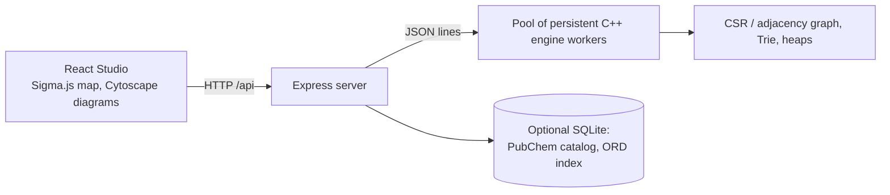

# ChemPath Studio

ChemPath is an interactive explorer for chemical reaction networks, built as a Data Structures
course project. A C++17 engine stores the reaction graph and runs the graph algorithms (BFS,
Dijkstra, A\*, Bellman-Ford, bidirectional search, Tarjan SCC, k-shortest paths, constrained and
Pareto search). A React frontend shows the results and can replay each traversal step by step.

The curated graph has 690 compounds, 884 reactions and about 3,044 directed links. Separately, an
optional local SQLite catalog holds up to 8 million real PubChem CID/SMILES structures for search.
Those structures add no reaction edges.

## Quick start

Requirements: Node.js 20+, npm, CMake 3.16+ and a C++17 compiler (`brew install cmake` on macOS).

```bash
npm install
npm run build:engine
npm run test:engine
npm run dev
```

Open http://localhost:5173. The API runs on http://localhost:8787.

To check everything offline in one command (engine, algorithms, API, production build):

```bash
npm run verify:release
```

## Architecture



- `engine/`: C++17 graph engine, CLI, tests and benchmarks. `chempath serve` loads the graph once
  and answers one command per line.
- `server/`: Express API. It validates input, then sends commands to a pool of engine workers
  (`CHEMPATH_ENGINE_WORKERS`, default 2), so one slow query does not block the rest.
- `web/`: Vite + React 19 + Tailwind/shadcn UI. The laboratory, data library and diagram view load
  on demand.
- `data/`: curated and expanded reaction datasets. Large imports (PubChem, ORD, full Rhea) stay
  out of Git.
- `scripts/`: importers, smoke tests and release verification.

In production a single Node process serves the built UI and the API on one origin. See
[docs/HOSTING.md](docs/HOSTING.md) for Docker and Railway.

## Common scripts

| Command                             | What it does                                                 |
| ----------------------------------- | ------------------------------------------------------------ |
| `npm run dev`                       | API on :8787 and Vite on :5173                               |
| `npm run build:engine`              | Configure and build the C++ engine                           |
| `npm run test:engine`               | C++ test suite (CTest)                                       |
| `npm run test:unit`                 | Server pool/validation tests and web Vitest tests            |
| `npm run lint` / `npm run format`   | ESLint / Prettier                                            |
| `npm run build:web`                 | Production frontend build                                    |
| `npm run verify:release`            | Full offline verification                                    |
| `npm run data:8m` / `data:full`     | Import the PubChem catalog (8M default, or the full source)  |

## Configuration

Copy `.env.example` to `.env`. The main settings are `PORT`, `CHEMPATH_DATA_DIR`,
`CHEMPATH_ENGINE_WORKERS`, `API_RATE_LIMIT`, `CORS_ORIGIN` (only for a separately hosted UI) and
`CHEMPATH_ORD_DB`.

## Documentation

- [Reference](docs/REFERENCE.md): every feature, algorithm, CLI command and dataset in detail
- [Studio UI](docs/STUDIO_UI.md) and [graph cartography](docs/STUDIO_CARTOGRAPHY.md)
- [DSA laboratory](docs/DSA_LAB.md)
- [PubChem catalog](docs/PUBCHEM_CATALOG.md), [ORD data](docs/ORD_DATA.md), [full Rhea import](docs/RHEA_FULL.md)
- [Hosting](docs/HOSTING.md)
- [Final review and demo guide](docs/FINAL_REVIEW.md)
- [Chemistry audit](data/CHEMISTRY_AUDIT.md)
- [Archive](docs/archive/): milestone B/C reports, benchmarks and the earlier 500K PubChem notes

## License

ChemPath Custom Academic & Non-Commercial License v1.0. Personal, educational, academic and
non-commercial research use is allowed with attribution; commercial use needs permission. See
[LICENSE](LICENSE).
